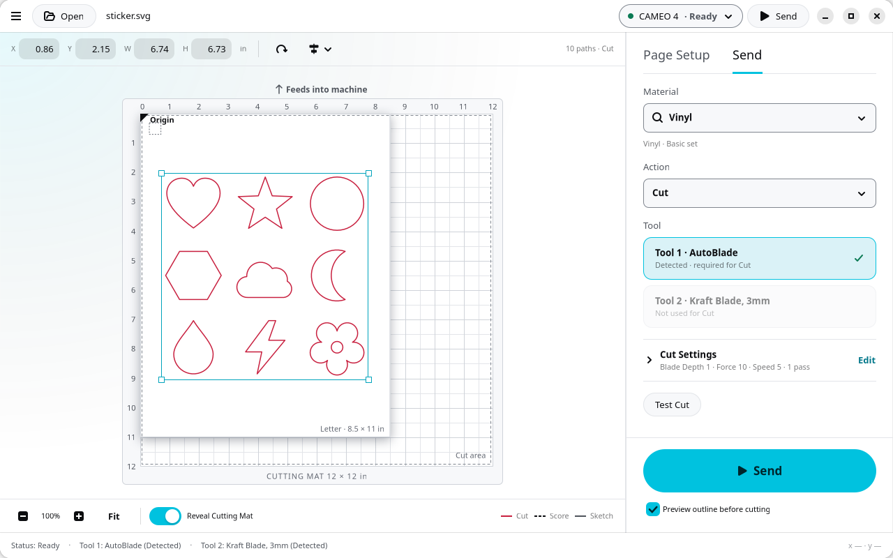
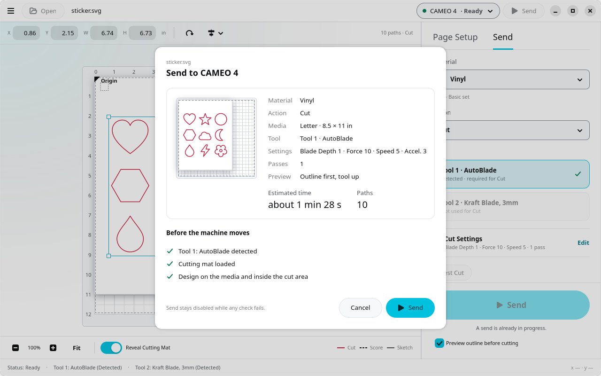
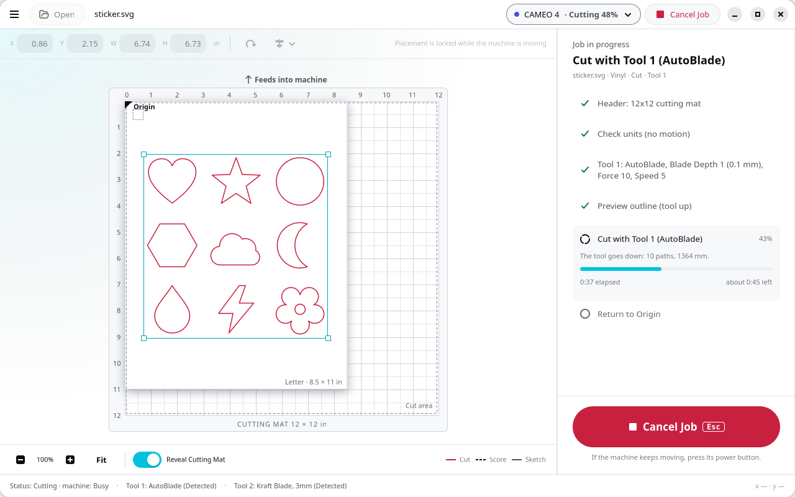
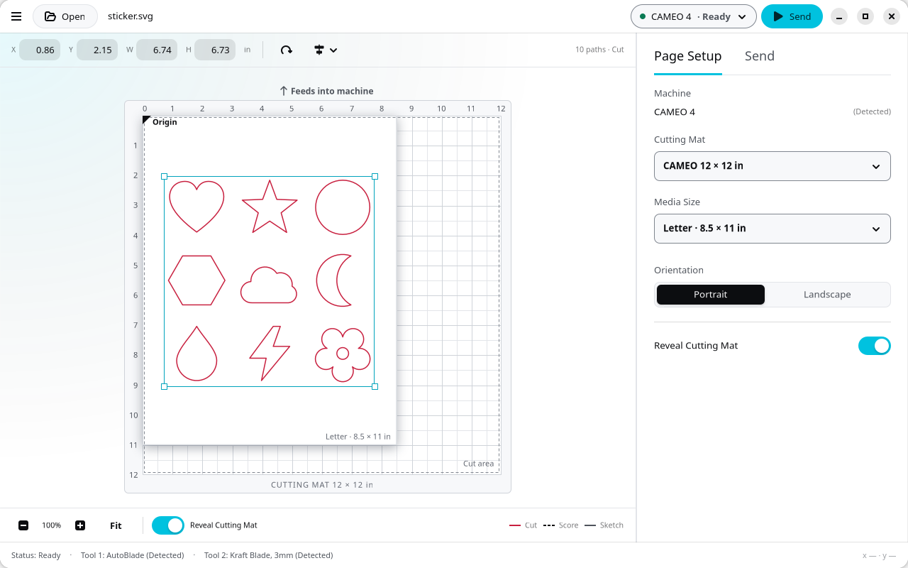

<p align="center">
  
</p>

<h1 align="center">OpenCutter</h1>

<p align="center">
  <strong>Cut your SVG designs on a Silhouette CAMEO from Linux.</strong><br>
  Free cutting software for crafters and makers on Linux: open an SVG, place it on the mat and
  send it to your cutting machine over Bluetooth.
</p>

<p align="center">
  <a href="https://github.com/MortyNiners/opencutter/releases"></a>
  <a href=".github/workflows/flatpak.yml"></a>
  <a href="LICENSE"></a>
</p>

<p align="center">
  <a href="#install">Install</a> ·
  <a href="#supported-machines">Supported machines</a> ·
  <a href="#safety">Safety</a> ·
  <a href="#faq">FAQ</a> ·
  <a href="#reporting-a-model">Report a model</a> ·
  <a href="CONTRIBUTING.md">Contributing</a>
</p>



Silhouette Studio, the software that comes with Silhouette cutting machines, is made for Windows
and macOS. If you want to use a Silhouette CAMEO on Linux, OpenCutter is a free alternative to
Silhouette Studio for the cutting step: draw your design in Inkscape or any other SVG editor, open
it in OpenCutter, load the mat and send the job to your vinyl cutter over **Bluetooth LE**. It is
a GTK 4 and libadwaita app that uses the words you know from Silhouette Studio: Material, Action,
Tool, Blade Depth, Force, Speed, Passes, Test Cut, Send. It needs no account, and the Flatpak has
no network access at all. OpenCutter is an independent project, not affiliated with Silhouette
America (see [Trademarks](#trademarks)).

**Which machines?** ([details](#supported-machines))

- **Tested on a real machine:** the CAMEO 4 with firmware V5.xx (tested on V5.05).
- **Not yet tested:** the CAMEO 4 with firmware V1.xx, CAMEO 4 Plus, CAMEO 4 Pro, CAMEO 5,
  CAMEO 5 Plus, CAMEO Pro MK-II, CAMEO 5 Alpha, CAMEO 5 Alpha Plus, Portrait 3 and Portrait 4.
  OpenCutter sends them jobs, but none of them has been run with it yet.
- **Recognized, not supported yet:** the CURIO 2, the CAMEO 3, the Portrait 2 and older USB-only
  models. OpenCutter names them but sends them no job.

> [!IMPORTANT]
> **Status: alpha, tested on one machine.** OpenCutter has sent SVG designs to one real
> CAMEO 4 (firmware V5.05) over Bluetooth and cut them, end to end; the built-in vinyl preset is
> the setting of an earlier 1-inch test cut in Oracal 651 vinyl on that machine. The other models
> it drives have not been tested on a real machine at all. Not yet tried on a real machine:
> stopping a running cut with Cancel Job, the other stops that [Safety](#safety) lists, and
> pausing and resuming a job (new in 0.1.1). Where a design lands against the printed grid of the
> mat has not been measured yet: use the outline preview and scrap material for your first jobs.
> OpenCutter moves a sharp blade: read [Safety](#safety) before you send anything.

## What it does

- **Opens your SVG designs** from Inkscape or any other editor (paths, basic shapes, `<use>`,
  transforms, mm/in/px units). Text and images are ignored with a warning: convert text to
  paths and trace images in Inkscape first.
- **Places the design on the mat.** You see your machine's cutting mat with its cut area, and
  you move, scale, rotate (by 90°) and align the design (Center to Page), or let Fit to Mat place
  it. The CAMEO 4 uses its 12 × 12 in mat; Page Setup offers the mats each other model has, such
  as the CAMEO 5's 12 × 24 in.
- **Lets you choose the material.** Material presets come from a small built-in Basic set (for
  the CAMEO 4 family) or from a presets file you write; for any other material, or a machine
  without presets, you set Speed, Force, Blade Depth and the other Cut Settings yourself. It
  cuts, scores or sketches with the tool in Tool 1 or Tool 2 (the Portrait 3 and 4 have one
  tool holder).
- **Shows the outline first.** An optional tool-up outline, the outer box of the design, is
  traced first and waits for you to confirm, so you see where the design will go before the
  tool goes down.
- **Sends the job over Bluetooth.** A background service (the daemon) holds the Bluetooth LE
  link. A command-line tool talks to the same service, so you can stop the machine from any
  terminal. The service releases the machine 15 minutes after you close the app, so other
  programs can use it again.
- **Lets you cancel at any time.** Cancel Job is one click (or Esc) and always visible while a
  job runs; it sends the machine's stop command at once. What that command does is only partly
  known: see [Safety](#safety).
- **Waits while the machine is paused.** The machine's Pause key pauses the job (on the CAMEO 4
  with firmware V5, so does **Pause** in the app). OpenCutter then sends it nothing but status
  queries until the machine goes on: press the Pause key again, or **Resume** in the app, and
  the job goes on from where it stopped. See [Safety](#safety).
- **Checks before anything moves.** The layout must be made for the connected machine, the
  detected tool must match the material's tool, and the design must lie inside the media and
  the cut area.

Not supported (yet): Print & Cut / registration marks, matless cutting, mats a model's profile
does not list (on the CAMEO 4: every mat but the 12 × 12 in), Rotary Cut and Punch (their presets
are hidden), the Material Editor, a USB connection, and the models listed as recognized under
[Supported machines](#supported-machines).

## Screenshots

<table>
  <tr>
    <td width="50%" align="center" valign="top">
      <a href="data/screenshots/main-window.png"></a>
      <br><sub>Lay out a design on the cutting mat and choose the material</sub>
    </td>
    <td width="50%" align="center" valign="top">
      <a href="data/screenshots/send-sheet.png"></a>
      <br><sub>Check the job, the media size and the checklist before the machine moves</sub>
    </td>
  </tr>
  <tr>
    <td width="50%" align="center" valign="top">
      <a href="data/screenshots/cutting.png"></a>
      <br><sub>Follow the job while it cuts, with Cancel Job always on screen</sub>
    </td>
    <td width="50%" align="center" valign="top">
      <a href="data/screenshots/page-setup.png"></a>
      <br><sub>Page Setup: the detected machine, the cutting mat and the media size</sub>
    </td>
  </tr>
</table>

## Supported machines

The Silhouette cutters that OpenCutter drives offer the same Bluetooth service, but they differ
in force limits, mats, tool holders and commands. OpenCutter reads the model and firmware a machine
reports and uses that model's profile: its mats, ranges, tool holders and commands
([docs/PROTOCOL.md](docs/PROTOCOL.md) describes each one).

| Status | Machine | Tool holders | Cutting mats |
|---|---|:---:|---|
| **Tested on a real machine.** | CAMEO 4 with firmware V5.xx, tested on V5.05. | 2 | 12 × 12 in |
| **Not yet tested.** | CAMEO 4 with firmware V1.xx | 2 | 12 × 12 in |
| | CAMEO 4 Plus | 2 | 15 × 15 in, 12 × 12 in |
| | CAMEO 4 Pro | 2 | 24 × 24 in, 12 × 12 in |
| | CAMEO 5 | 2 | 12 × 12 in, 12 × 24 in |
| | CAMEO 5 Plus | 2 | 15 × 15 in, 12 × 12 in, 12 × 24 in |
| | CAMEO Pro MK-II | 2 | 24 × 24 in, 15 × 15 in, 12 × 12 in, 12 × 24 in, 8 × 12 in |
| | CAMEO 5 Alpha | 2 | 12 × 12 in, 12 × 24 in |
| | CAMEO 5 Alpha Plus | 2 | 12 × 12 in, 12 × 24 in |
| | Portrait 3 | 1 | 8 × 12 in |
| | Portrait 4 | 1 | 8.5 × 12 in |

OpenCutter sends jobs to the models that are not yet tested, but none of them has been run with
it yet. Their profiles were written from Silhouette Studio's machine data and an analysis of
their firmware, with a few values from captures and reports that others have published. Keep the
outline preview on, use scrap material and keep the power button within reach for your first
jobs. On the Portrait 3 and the Portrait 4 the check after the mat is loaded cannot confirm the
cut area yet, because the reply these machines give is not known: OpenCutter logs and shows the
reply but does not check it.

**Recognized, not supported yet.** OpenCutter names these models but sends them no job:

| Machine | Why OpenCutter cannot drive it yet |
|---|---|
| CURIO 2 | The work area of its trays, its tool height and the material thickness are not known. |
| CAMEO 3, Portrait 2 | There is no known way to stop them from the computer, and they do not report which tools are loaded. |
| CAMEO 1, CAMEO 2, Portrait 1, CURIO 1, Silhouette SD, CC300, CC300L, CC100, CC200 | They need a USB connection, which OpenCutter does not have, and there is no known way to stop them from the computer. |

If you own a model that is not yet tested, or one that OpenCutter only recognizes, a report of
how it went helps a lot: see [Reporting a model](#reporting-a-model), and "Reporting a model" in
[CONTRIBUTING.md](CONTRIBUTING.md#reporting-a-model) for the details.

### Other Silhouette machines

When the background service connects to a paired machine, it first asks for its status and its
model. If the machine reports a model or firmware line that OpenCutter does not drive (a
recognized model, or one it does not know at all), the service sends it nothing more and releases
its Bluetooth link at once, so other programs can use it. The app then shows "Unsupported
Machine" with the model the machine reported, and Send stays disabled; `opencutter service
status` shows the reported model with "refused" and, for a recognized model, the reason. The
service does not try that machine again while it runs; it connects by itself to another paired
machine that it drives, once you switch that one on.

## Install

OpenCutter runs on Linux with BlueZ, the Bluetooth service of most distributions. You pair the
machine in your desktop's Bluetooth settings, with the Flatpak too: see [First run](#first-run).

### The Flatpak

Each release on <https://github.com/MortyNiners/opencutter/releases> has a Flatpak bundle for
64-bit PCs (x86_64), `opencutter-<version>.flatpak`, and a file `SHA256SUMS` with its checksum.
The current release is [0.1.1](https://github.com/MortyNiners/opencutter/releases/tag/v0.1.1),
with the bundle `opencutter-0.1.1.flatpak`. There is no bundle for ARM computers yet; on those,
OpenCutter can run [from source](#from-source). OpenCutter is not on Flathub, but the bundle runs
on the GNOME 51 runtime from Flathub. You need Flatpak (see <https://flatpak.org/setup/>).

Download the bundle and `SHA256SUMS` into one folder, from the release page or with the first
two commands below. In that folder, check the download and install the bundle for your user:

```sh
curl -LO https://github.com/MortyNiners/opencutter/releases/download/v0.1.1/opencutter-0.1.1.flatpak
curl -LO https://github.com/MortyNiners/opencutter/releases/download/v0.1.1/SHA256SUMS
sha256sum --check SHA256SUMS                       # prints: opencutter-0.1.1.flatpak: OK
flatpak install --user ./opencutter-0.1.1.flatpak
```

`sha256sum --check` shows that the download is complete and unchanged; it does not show who
made the file, so download both files from the release page above only.

`flatpak install` lists what it will install, with the sizes, and asks first. The bundle names
Flathub as the place of its runtime: without the Flathub remote, `flatpak install` adds it (as
`flathub`), and without the GNOME 51 runtime, it installs the runtime from there too, with the
graphics drivers and translations that go with it. When none of these is installed yet, that is
up to about 1.5 GB to download and 2.5 GB on disk; much less when you already use other Flathub
apps. To add the Flathub remote yourself beforehand:

```sh
flatpak remote-add --user --if-not-exists flathub https://dl.flathub.org/repo/flathub.flatpakrepo
```

Then open OpenCutter from your app menu, or run:

```sh
flatpak run io.github.mortyniners.OpenCutter
```

**Updates.** A bundle does not update by itself, and `flatpak update` does not look for new
releases of it. To update, download the newer bundle and install it the same way, for example
`flatpak install --user ./opencutter-0.2.0.flatpak`. A window that is open during the update
keeps its version until you close it.

**Uninstall.** First release the machine: press **Disconnect** in the app, or run
`flatpak run --command=opencutter io.github.mortyniners.OpenCutter service stop`. The
background service runs on for up to 15 minutes after you close the app, also after an
uninstall, and then this command no longer exists. If you forgot, the service ends by itself
within those 15 minutes; until then, other programs cannot use the machine. Then:

```sh
flatpak uninstall --user io.github.mortyniners.OpenCutter
flatpak uninstall --user --unused        # the GNOME 51 runtime, when nothing else uses it
```

The first command keeps your settings, presets file and service log; with `--delete-data`
(`flatpak uninstall --user --delete-data io.github.mortyniners.OpenCutter`) it removes them as
well. After an uninstall without it, delete the folder `~/.var/app/io.github.mortyniners.OpenCutter`
yourself. The second command leaves a runtime that you installed by name yourself: Flatpak pins
such a runtime (`flatpak pin --user` lists it).

**The command line.** In the Flatpak, the commands of [Command line](#command-line) start with
`flatpak run --command=opencutter io.github.mortyniners.OpenCutter`, for example:

```sh
flatpak run --command=opencutter io.github.mortyniners.OpenCutter service status
```

An alias in your shell saves typing:
`alias opencutter='flatpak run --command=opencutter io.github.mortyniners.OpenCutter'`.

**Files.** The Flatpak keeps its files in `~/.var/app/io.github.mortyniners.OpenCutter/`, not
where a copy from source keeps them:

| File | In the Flatpak, under `~/.var/app/io.github.mortyniners.OpenCutter/` | From source |
|---|---|---|
| Presets file (see [Material presets](#material-presets)) | `data/opencutter/presets.json` | `~/.local/share/opencutter/presets.json` |
| Settings | `config/opencutter/gui.json` | `~/.config/opencutter/gui.json` |
| Service log | `.local/state/opencutter/daemon.log` | `~/.local/state/opencutter/daemon.log` |
| App log | `.local/state/opencutter/app.log` | `~/.local/state/opencutter/app.log` |

From source, `$XDG_DATA_HOME`, `$XDG_CONFIG_HOME` and `$XDG_STATE_HOME` replace
`~/.local/share`, `~/.config` and `~/.local/state` when they are set. To use a presets file you
already have with the Flatpak, copy it there, then restart the app:

```sh
mkdir -p ~/.var/app/io.github.mortyniners.OpenCutter/data/opencutter
cp ~/.local/share/opencutter/presets.json ~/.var/app/io.github.mortyniners.OpenCutter/data/opencutter/
```

**Permissions.** The Flatpak may use the window, the GPU and BlueZ on the system bus, and
nothing else: no network, and no files except the designs you open with **Open** or drop on the
window. Its background service runs in a Flatpak sandbox of its own (`flatpak ps` lists it), so
it outlives the window, as described under [Troubleshooting](#troubleshooting). End it with
**Disconnect** or `service stop`, not with `flatpak kill`: that ends it at once, without
releasing the Bluetooth link, and the machine may then need to be switched off and on.

**Background Apps.** While the service runs and the window is closed, GNOME lists OpenCutter
under Background Apps in the quick settings, where the service says "Holds the CAMEO 4 link" (for
another model, its name, or "the link to the cutter" when the name is too long).
Do not close it there: GNOME then ends it like `flatpak kill`. For the same reason, if
Settings → Apps → OpenCutter has a **Run in Background** switch, leave it on: when it is off,
the desktop ends the service in the same way soon after the window closes.

### From source

On a distribution with GNOME 49 or newer, OpenCutter also runs from source, with GTK 4,
libadwaita and PyGObject from the distribution. It needs GTK 4.20, libadwaita 1.8 and PyGObject
3.50 or newer, Python 3.12 or newer, and BlueZ. On Debian or Ubuntu:

```sh
sudo apt install python3-gi gir1.2-gtk-4.0 gir1.2-adw-1 pipx git
```

On Fedora:

```sh
sudo dnf install python3-gobject gtk4 libadwaita pipx git
```

This shows which versions you have (on Ubuntu 26.04: PyGObject 3.56.2, GTK 4.22, libadwaita
1.9):

```sh
python3 -c 'import gi; gi.require_version("Gtk", "4.0"); gi.require_version("Adw", "1"); from gi.repository import Gtk, Adw; print("PyGObject", gi.__version__, "GTK 4.%d" % Gtk.get_minor_version(), "libadwaita 1.%d" % Adw.get_minor_version())'
```

Then fetch a release and install it with pipx. `--system-site-packages` lets OpenCutter use the
system's PyGObject; pipx installs bleak, dbus-fast and svgelements from PyPI:

```sh
git clone --branch v0.1.1 https://github.com/MortyNiners/opencutter.git
pipx install --system-site-packages ./opencutter
opencutter
```

If your shell does not find `opencutter`, run `pipx ensurepath` once and open a new terminal.
Instead of pipx, a virtual environment with the system's site packages works as well (on Debian
or Ubuntu it needs `python3-venv`):

```sh
python3 -m venv --system-site-packages ~/.local/opt/opencutter
~/.local/opt/opencutter/bin/pip install ./opencutter
~/.local/opt/opencutter/bin/opencutter
```

A copy from source has no entry in the app menu: start it with `opencutter` (from a virtual
environment, with its `bin/opencutter`). To update, clone the newer release's tag into a new
folder and install that folder the same way, with `pipx install --force
--system-site-packages` (or `pip install` into the same virtual environment).

### Known limitations

- **Ending the background service outside the app skips the stop.** Closing OpenCutter's entry
  under Background Apps in GNOME's quick settings and `flatpak kill` end the service at once; a
  **Run in Background** switch turned off in Settings → Apps → OpenCutter ends it the same way
  soon after the window closes. The service then sends no stop to the machine and does not
  release the Bluetooth link cleanly, so the machine may need to be switched off and on before
  it connects again. To release the machine, press **Disconnect** in the app's connection menu
  (or run `service stop`, see [The Flatpak](#the-flatpak)). During a job, cancel it first, and
  press the machine's power button if it keeps moving.
- **The bundle is not signed.** Nothing shows who made a downloaded bundle: download it and
  `SHA256SUMS` from the release page only, and check the bundle with `sha256sum --check
  SHA256SUMS` before you install it (see [The Flatpak](#the-flatpak)).
- **From source, the app needs GNOME 49 or newer**, with GTK 4.20, libadwaita 1.8 and PyGObject
  3.50 or newer from the distribution (see [From source](#from-source)). On an older
  distribution, use the Flatpak, which runs on the GNOME 51 runtime from Flathub.

## First run

1. **Pair the machine.** Switch the machine on and pair it in GNOME Settings → Bluetooth (or
   your desktop's Bluetooth settings). Its name starts with "CAMEO" or "Portrait".
2. **Power cycle it.** Switch the machine off and on again: the settings panel may still hold the
   link from pairing, and OpenCutter's service refuses to share a link that another program
   holds. The CAMEO 4 also accepts a new Bluetooth connection only after it was switched on.
3. **Start OpenCutter.** The app starts its background service by itself and connects. Until a
   machine answers, the welcome dialog speaks of "your machine"; then the status pill in the
   header bar shows the machine's name and state, for example "CAMEO 4 · Ready". If it stays on
   "Connecting…", switch the machine off and on once more. When it cannot connect, the banner
   under the header bar says why, for example when another program holds the machine's
   Bluetooth link. "Unsupported Machine" means that the machine reported a model or firmware
   line OpenCutter does not drive; for a model it recognizes, the app names it and says why
   (see [Other Silhouette machines](#other-silhouette-machines)).
4. **Use the machine's layout.** Until a machine is connected, the layout is made for the
   machine you last used or chose in Page Setup (at first, the CAMEO 4). When your machine is
   another model, a banner says that the layout now uses that machine; check it and press the
   banner's button, for example **Use CAMEO 5** (see
   [Another machine than the layout's](#another-machine-than-the-layouts)).

## Using it

1. **Open** an SVG (or drag it onto the window).
2. In **Page Setup**, check the machine, choose the Cutting Mat and the media size; the design is
   placed where it sits on its SVG page.
   - **Machine** shows the connected machine with "(Detected)". While no machine is connected
     you choose it here: the list has every model OpenCutter drives. The app remembers the
     choice.
   - **Cutting Mat** lists that machine's mats, for example 12 × 12 in and 12 × 24 in on the
     CAMEO 5; the app remembers the mat you chose for each machine (Preferences sets it too).
     **Media Size** offers Letter, A4, the mat's own size and Custom; media larger than the mat
     is cut down to the mat. Set it to the sheet you cut: Send stays disabled while any part of
     the design lies off the media (up to 0.5 mm past its edge is allowed, for rounding) or
     outside the cut area, and the background service refuses such a job too. With Media Size
     set to the whole mat it cannot keep the blade on a smaller sheet; the Send sheet says so.
   - The **Align** menu next to Rotate moves the design: **Center to Page** (Ctrl+Shift+C)
     centers it on the media, inside the cut area; Align Center and Middle center it on one
     axis, and Align Left, Right, Top and Bottom move it against that edge of the cut area on
     the media. Tip: set the media size to your sheet, for example Custom 12 × 5 in, and Center
     to Page centers the design on the sheet.
3. In **Send**, choose the **Material** and the **Action**. The Material list shows the settings
   each material applies, for example "Cut · AutoBlade · Blade Depth 1 · Force 10 · Speed 5".
   Only a preset marked verified is chosen for you; otherwise Send and Test Cut stay disabled
   until you choose a material. A machine with no presets of its own says "No materials for
   this machine yet" and offers **Use Cut Settings** (see [Material presets](#material-presets)).
   The **Tool** cards show what the machine detects in Tool 1 and Tool 2 (on the Portrait 3 and
   4, one card, Tool); Send stays disabled until the right tool is loaded. **Cut Settings** uses
   the machine's own ranges, for example Force up to 40 on the CAMEO 5, and has no Acceleration
   on the Portrait 3.
4. **Put the sheet on the mat and load it.** Put the top-left corner of your sheet on the
   top-left corner of the mat's grid: OpenCutter lays the media out from there, in the Media
   Size chosen in Page Setup (the Send sheet shows it in its Media row). Where the machine's
   origin falls on the printed grid has not been measured yet: the outline preview (step 5)
   shows where the design will go. Then **Load the Cutting Mat**
   on the machine (the sheet names the mat when the machine has more than one) and press
   **Send**. Check the summary and press **Send** again.
5. With "Preview outline before cutting" on, the tool traces the outer box of the design with
   the tool up and waits. Check that it stays over your media, then press **Cut**.
6. **While the job runs**, the job view shows each step and **Cancel Job**. To pause, press the
   machine's Pause key, or (on the CAMEO 4 with firmware V5) **Pause** above Cancel Job while a
   step runs: one click asks the machine once. While the machine is paused, the status pill says
   "Paused", the job view says what to do, the time left stops, and OpenCutter sends it nothing
   but status queries. Press the Pause key again, or **Resume** (shown only when the background
   service would send it), and the job goes on from where it stopped; **Cancel Job** ends it
   (see [Safety](#safety)). Neither command is ever sent again by itself: if the machine is
   still paused 5 seconds after Resume, or did not pause after Pause, the job view says so. When
   the machine has not answered for 7 seconds, the pill reads "Checking connection": OpenCutter
   keeps waiting and sends nothing new.
7. **After the job.** The finished page has **Stop Machine**, which sends the machine's stop
   command (see [Safety](#safety)), and **Cut Again** (after a job that did not finish:
   **Send Again…**). Before the next job, press **Unload** on the machine and load the mat
   again: after a job and after a lost connection, until the machine has reported an unloaded
   mat, Send, Cut Again, Send Again… and Test Cut first show the Load sheet, even when the
   machine shows Ready. When the page says "Nothing was sent" (the background service refused
   the job before its first step), no reload is needed.

**Test Cut** cuts a 10 mm square with a triangle inside near the top-left corner of the media,
with the current settings, so you can check Force and Blade Depth before the real job.

**Preferences** sets the default media size and, on a machine with more than one mat, the default
Cutting Mat of the layout's machine. Its Machine group names the model, for example "CAMEO 5"; for
a machine that OpenCutter does not drive it adds "Recognized, not supported yet" or "Not
supported".

### Another machine than the layout's

A layout is made for one machine and one of its mats, and OpenCutter sends a job only to that
machine. When the background service connects to a machine of another model than the layout's
(say a CAMEO 5, while the layout was made for the CAMEO 4), the machine wins: the app switches the
layout to it. Page Setup takes the new machine's mat (the one you chose for it before, else its
usual mat) and cuts the media down to that mat if needed; the Tool cards, the Cut Settings ranges
and the Material list become those of the new machine. Your design stays where it is: if it no
longer lies inside the cut area, Send says so and **Fit to Mat** moves it in. A banner under the
header bar tells you about the switch, and Send and Test Cut stay disabled until you have checked
the layout and pressed the banner's button, **Use CAMEO 5** (the machine's name). While a machine
is connected, Page Setup shows it and offers no other: the connected machine decides.

### Models that are not yet tested

For a model that OpenCutter drives but that has not been run with it yet (see
[Supported machines](#supported-machines), which says which models those are), the app shows no
note about testing, and Send works as for the CAMEO 4. Keep the outline preview on and use scrap
material for your first jobs.

On the Portrait 3 and 4, the reply the machine gives after the mat is loaded is not known yet, so
OpenCutter cannot use it to confirm the cut area. Page Setup and the Send sheet say so ("The cut
area cannot be checked with this mat on this model yet"). When the machine answers, the job goes on
all the same, and the job view shows "The cut area could not be checked on this model." with the
machine's reply; when it does not answer in that form at all, the job stops before the cut. Load
the mat right before every job, and if you send a report, include that reply.

## Safety

OpenCutter moves a sharp blade, and not every stop has been tried yet. Not yet tried on a real
machine: stopping a running cut with Cancel Job, Stop Machine after a job, a lost connection or a
quit during a job, the stop the background service sends again when a lost connection comes back,
and, new in 0.1.1, the machine's own Pause and Unload keys during a job, Pause and Resume in the
app, and Cancel Job while the machine is paused. What the machine's stop command does is known
only from an analysis of its firmware (see below). Keep the power button within reach.

- **Load the Cutting Mat right before every job.** The machine applies the mat setting only
  right after a load. If you loaded the mat before an earlier job, press Unload, then Load.
  OpenCutter checks this: the app stops the job before any tool goes down when the machine's
  units do not match or cannot be confirmed (on the Portrait 3 and 4 it can only show the
  machine's reply, see [Models that are not yet tested](#models-that-are-not-yet-tested)).
  After every job that sent anything to the machine (a finished one too) and after a lost
  connection, the app shows the Load sheet before the next job until the machine has reported
  an unloaded mat, even when it shows Ready.
- **Do not unload the mat during a job**, not even at the outline check: press Cancel instead.
  If the machine reports an unloaded mat after the job started, OpenCutter sends nothing more
  (a step under way ends with the stop command); load the mat and send the job again.
- **The machine's Pause key pauses the job.** A short press of the Pause key during a job (or
  **Pause** in the job view, on the CAMEO 4 with firmware V5) pauses it. From an analysis of the
  CAMEO 4's firmware, the machine first finishes the moves it has already planned (at most
  eight), then lifts the tool and keeps the rest of the job. While it is paused, OpenCutter
  sends it nothing but status queries, for as long as it stays paused, and the status pill says
  "Paused". To go on from where it stopped, press the Pause key again, or **Resume** in the job
  view (on the CAMEO 4 with firmware V5): the tool may come down at once, so keep your hands
  clear. To end the job, press **Cancel Job**: a paused machine ends the job about 5 seconds
  after the stop. A long press of the Pause key, or **Unload**, while the machine is paused also
  ends the job, and OpenCutter then ends it too. If the machine leaves Pause without going on
  (it reports Ready with no Busy in between) after a pause in the middle of a cut, OpenCutter
  cannot tell that from a cancel on the machine's panel: it ends the job with its stop command,
  and the app says to press **Unload**, check that the tool is up, then load the mat and send
  the job again. None of this has been tried on a real machine yet.
- **A paused machine without an OpenCutter job is not continued.** When the machine is paused
  but no job of OpenCutter waits for it (for example a job of another program), the Load sheet
  says to press **Unload** (or switch the machine off and on). Do not press Pause to continue
  such a job: what the machine still holds would then run with nothing watching it.
- **Cancel Job** is one click (or Esc) and is always visible while a job runs. It sends the
  machine's stop command at once; the job view says "Stopping…" until the background service says
  whether the command went out, and Send waits until then. While the machine is paused, Cancel Job
  also waits for the machine to end the job: the job view says "Cancelling…" until it reports
  Ready or Load Media (for up to 15 seconds), and if it still reports Paused then, the page says
  so: press **Unload** on the machine. Closing the window during a job asks first, then stops the
  machine (right after Cancel Job, it waits for that stop). If the app ends without asking (it
  crashes or is killed, or the terminal that started it is closed or gets Ctrl+C), the background
  service sends the stop command only when that happens while a step runs; between steps, for
  example at the outline check, the machine has already reported Ready and gets nothing. If the
  background service itself is killed at once (for example with `flatpak kill`), nothing sends the
  stop: use the power button. Start the app from your desktop rather than from a terminal you
  might close.
- **Stop Machine** on the page after a job (and in the header bar after a job that did not
  finish) sends the machine's stop command, each time you press it, and reads back what the
  machine reports; without a connection it is disabled: use the power button. `opencutter stop`
  does the same from any terminal. If the machine still reports Busy after it, press the power
  button; if it still reports Paused, press Unload on the machine.
- **What the stop command does is only partly known.** OpenCutter's stop is the machine's own
  stop command (ESC 09), sent twice. From an analysis of the CAMEO 4's firmware: while the
  machine cuts, it first finishes the moves it has already planned (at most eight) with the
  tool still down, then lifts the tool, stops and drops the commands it was sent but has not
  run; a paused machine ends the job about 5 seconds after the stop, or later while commands
  still reach it (OpenCutter sends it none, only status queries). Stopping a running cut has
  not been tried on a real machine yet: keep the power button within reach. After a stop, press
  Unload before the next job, or the power button if anything moves.
- **The power button is the last resort.** If the machine keeps moving, or the app loses the
  Bluetooth link during a job, press the machine's power button: without the link no stop can
  reach the machine. When the link was lost while the machine may have been moving, the
  background service keeps the stop for that machine and sends it once as soon as the same
  machine is connected again (while the service still runs); the app tells you so. This has not
  been tried on a real machine yet, and it is no reason to wait: press the power button.
- **Do not log out, shut down or let the computer sleep during a job.** That ends the link in
  the middle of a cut, and the machine may finish what it was sent last on its own. While a job
  runs, the app asks the desktop not to suspend, and to ask you before a logout or shutdown.
- Keep your hands away from the carriage and the rollers while the machine moves, and leave free
  space behind the machine: the mat moves through it.
- Use the Test Cut on a corner of new material before cutting a whole design.
- **Models that were not tested.** On every model but the CAMEO 4 with firmware V5.xx, OpenCutter
  has never cut anything (see [Supported machines](#supported-machines)). Keep the outline preview
  on, use scrap material, start with a light Force and keep the power button within reach. On the
  Portrait 3 and 4 the check after loading cannot confirm the cut area yet: load the mat right
  before every job.
- For your first jobs, keep "Preview outline before cutting" on and use scrap material: the
  position against the mat grid has not been measured yet.

## Material presets

**Basic set.** OpenCutter has a small built-in Basic set: one vinyl cut setting verified on our
CAMEO 4 (the same values as Studio's "Vinyl, Silhouette Oracal 651" preset) and one untested
Sketch Pen starting point. Make a Test Cut before you rely on either. The Basic set is for the
CAMEO 4 family: the CAMEO 4 Plus and Pro get the same two settings, not verified on them. The
other models have no Basic set: use Cut Settings or a presets file.

**Other materials.** Choose the closest material, open **Cut Settings** and adjust Blade Depth,
Force and Speed (and Acceleration, Passes, Line Segment Overcut and Overcut if needed). Make a
Test Cut on a corner of the material and adjust again until it cuts cleanly. **Reset to preset**
goes back to the preset's values.

**A machine without materials.** Each machine is offered only the presets made for it (see "Which
presets a machine gets" below), so a CAMEO 5 without a presets file, for example, has none: the
Material field says "No materials for this machine yet". Press **Use Cut Settings** under it (or
in the Material list). The Material then reads "Cut Settings": choose the Tool card of the holder
you use and the tool that is in it, and set Blade Depth, Force and Speed in **Cut Settings**,
which open with light first values (the lowest Force, Speed 5). Make a Test Cut, raise the Force
until it cuts cleanly, and then send the job; **Reset** goes back to the first values. OpenCutter
never picks these for you: until you press Use Cut Settings, Send and Test Cut stay disabled.

**Your own presets file.** If the file `$XDG_DATA_HOME/opencutter/presets.json` exists (by
default `~/.local/share/opencutter/presets.json`), OpenCutter offers the presets in it instead of
the Basic set. OpenCutter only reads this file and never changes it; restart the app after you
edit it. If the file cannot be read, or a value in it is outside the ranges of a machine it names,
OpenCutter uses the Basic set and prints a warning in the terminal it was started from.

The file is JSON. This one holds the Basic set's vinyl setting:

```json
{
  "format": "opencutter-presets",
  "schema": 1,
  "description": "My cutting settings",
  "presets": [
    {
      "material": "Vinyl",
      "material_type": "Vinyl",
      "action": "Cut",
      "holder": 1,
      "tool": "AutoBlade",
      "tool_code": 2,
      "speed": 5,
      "force": 10,
      "acceleration": 3,
      "offset": 18,
      "line_segment_overcut": false,
      "overcut": [1, 1],
      "blade_depth": 1,
      "passes": 1,
      "verified": true
    }
  ]
}
```

This is a schema 1 file: every preset in it is for the CAMEO 4 alone. For other models, write
`"schema": 2` and give each preset the machines it is for, for example
`"machines": ["cameo4", "cameo4_plus", "cameo4_pro"]`.

| Key | Meaning |
|---|---|
| `format`, `schema` | Always `"opencutter-presets"`; the schema is `1` or `2`. In a schema 1 file every preset is for the CAMEO 4, and a `machines` key is an error. In a schema 2 file each preset may name its machines. |
| `description` | Optional. A short text shown as the source of the presets, in Preferences and under the Material (first line, up to 80 characters). Without it the app shows "Presets file". |
| `presets` | The list of presets, at least one. In a schema 1 file other top-level keys and preset keys are ignored. In a schema 2 file any other top-level key, and any key a preset does not have, is an error, so a misspelt `machines` cannot pass unnoticed. A top-level `machines` is an error in both: machines are named per preset. |

Each preset is one Material + Action + tool holder; each such combination may appear only once for
each machine, so one material may have a preset for the CAMEO 4 and another for the CAMEO 5. All
numbers are whole numbers. The values must suit every machine the preset names: the ranges below
are the CAMEO 4's, with the other models' where they differ (every model's are in
[docs/PROTOCOL.md](docs/PROTOCOL.md), section 11).

| Field | Meaning | Values |
|---|---|---|
| `material` | Name in the Material list. | text |
| `material_type` | Group in the Material list, for example `"Vinyl"` or `"Cardstock"`. | text |
| `action` | `"Cut"`, `"Sketch"`, `"Score"`, `"Kraft Cut"`, ... | text |
| `holder` | Tool 1 (left) or Tool 2 (right); `1` on the Portrait 3 and 4, which have one holder. | `1`, `2` |
| `tool` | Tool name shown in the app. | text |
| `tool_code` | The tool the machine must detect in that holder before anything moves: 1 Ratchet Blade, 2 AutoBlade, 3 Deep-Cut Blade, 4 Kraft Blade (2mm in Tool 1, 3mm in Tool 2), 7 Sketch Pen, 8 Foil Tool (Tool 2 only on the CAMEO 4, 4 Plus and 4 Pro; either holder on the CAMEO 5 family; the Portrait 4). Presets for 5 (Rotary Blade) and 6 (Punch Tool) are read but not offered. | `1`..`8` |
| `speed` | Speed, in cm/s. The Portrait 3 and 4: `1`..`10`. | `1`..`30` |
| `force` | Force. The CAMEO 5, 5 Plus, Pro MK-II, 5 Alpha and 5 Alpha Plus: `1`..`40`. | `1`..`33` |
| `acceleration` | Acceleration. The Portrait 4: `1`..`3`. The Portrait 3 has none: the value is not sent to it, but it must still be a whole number. | `1`..`10` |
| `offset` | Blade offset: usually 18 for the AutoBlade, Ratchet Blade and Deep-Cut Blade, 88 for the Kraft Blade 2mm and 68 for the Kraft Blade 3mm. `0` for the Sketch Pen and the Foil Tool. The Portrait 3 and 4: `0`..`45`. | `0`..`99` |
| `line_segment_overcut` | Line Segment Overcut. `false` for the Sketch Pen and the Foil Tool. | `true`, `false` |
| `overcut` | Overcut at the start and at the end of a cut, in steps of 1/9 mm. `[0, 0]` for the Sketch Pen and the Foil Tool. | `[0..9, 0..9]` |
| `blade_depth` | Blade Depth, in steps of 0.1 mm. Only for the AutoBlade in Tool 1 (on the Portraits, the AutoBlade); `null` for every other tool. | `0`..`10` or `null` |
| `passes` | How many times each path is cut. | `1`..`10` |
| `verified` | Optional, default `false`. `true` only for a setting you cut and checked on a real machine of every model the preset names; with no material remembered, the app starts on a verified one, and with none verified it chooses no material for you. | `true`, `false` |
| `machines` | Optional, only in a schema 2 file. The machines this preset is for; its values must suit every one of them. Without it the preset is for the CAMEO 4 alone. The ids: `cameo4`, `cameo4_plus`, `cameo4_pro`, `cameo5`, `cameo5_plus`, `cameo_pro_mk2`, `cameo5_alpha`, `cameo5_alpha_plus`, `portrait3`, `portrait4`. | a list of ids, at least one, each once |

OpenCutter checks these values when it reads the file, and again before it sends a job. An id it
does not know, or one of a model it only recognizes, is an error like a value out of range.

**Which presets a machine gets.** A presets file replaces the Basic set for every machine, and
each machine is offered only the presets that name it. A preset without `machines` is for the
CAMEO 4 alone, so a schema 1 file gives the CAMEO 4 Plus, the CAMEO 4 Pro and every other model no
presets: for them, write a schema 2 file that names them.

In the Flatpak, the presets file is
`~/.var/app/io.github.mortyniners.OpenCutter/data/opencutter/presets.json` instead;
[Install](#install) shows how to copy one you already have there.

## Command line

Every command goes through the background service; start it with `opencutter serve` if the
app is not running.

```text
opencutter                 start the app
opencutter serve           hold the Bluetooth link (the app starts this by itself)
opencutter status          the machine, its model, its machine profile and its status
opencutter info            status, tools, sensor, firmware, machine profile and test programs
opencutter stop            stop the MACHINE now, from any terminal (the service keeps running)
opencutter pause           pause the job that runs now, as the machine's Pause key does
opencutter resume          go on with the paused job, from where it stopped
opencutter service stop    stop the background service, which releases the machine
opencutter service status  which background service runs: version, build, process, machine,
                           model
opencutter dry-run         motion test with the tool always up (nothing touches the mat)
opencutter pen-test        20 mm square with a Sketch Pen in Tool 1
opencutter cut-test        cut one 1-inch grid square in adhesive vinyl (AutoBlade, Tool 1)
opencutter --version       the version and build of this copy of OpenCutter, and its API
```

`opencutter --help` ends with the machines this copy drives: the tested ones, the ones not yet
tested, and the ones it only recognizes. `opencutter status` names the machine's profile and
whether it was tested, for example `profile: CAMEO 5 (cameo5), not yet tested on this model`
(for a CAMEO 4 on firmware V1.xx: `not yet tested with this firmware`); `opencutter info` adds
`Profile:` and `Test programs:` lines. For a machine that is not tested, `opencutter service
status` adds the same words and the profile id to its `model:` line, and for a recognized model
it shows `refused:` with the reason. The test programs (`dry-run`, `pen-test`, `cut-test`) exist
for the CAMEO 4 only: on another model they say so and send nothing.

The test programs explain what to prepare and run one step per Enter; Ctrl+C stops the
machine. A step has no time limit: while the machine is paused it waits, and the program prints
`.. the machine is paused (status '3'). Press its Pause key to go on, run 'opencutter resume' in
another terminal, or press Ctrl+C to stop.`, then `.. the machine goes on (status '1').` when it
does. It also says when the machine has not answered for 7 s or more (the service keeps
waiting), and it sends the stop when the background service itself does not answer three pings
in a row, 2 s apart.

`opencutter pause` and `opencutter resume` act on the job or test program that runs now, from
any terminal, and only on the CAMEO 4 with firmware V5. Each sends the machine's command once
(ESC 07 to pause, ESC 08 to go on), and only after a fresh status read: Resume only while the
running job waits on a paused machine, Pause only while it runs and the machine reports Ready
or Busy. Nothing is ever sent again by itself. They print what was sent and what the machine
reports afterwards, for example `Resume sent (ESC 08); the machine now reports 1 = Busy.`, or
why nothing was sent (`Not sent: the machine is not paused (status '1' = Busy)`). While a job
waits on a paused machine, `opencutter status` adds `Paused (the open job waits for the
machine)`.

`opencutter stop` (and Ctrl+C in a test program) prints a second line with the status the machine
reports after the stop (read for up to 3 s while it reports Busy or Cancelling, and for up to 15 s
once it reported Paused: a paused machine ends the job about 5 s after the stop), for example `the
machine now reports status '0' = Ready.`; when it still reports Busy, it says to press the power
button, and when it still reports Paused, to press Unload on the machine. A Ready status says what
the machine reports, not that every move it was sent is gone. The service log (see
[Troubleshooting](#troubleshooting)) shows the machine's status changes (Ready and Busy only
during a job and for 30 s after a stop); `opencutter serve -v` logs those at any time, and also
every write and every reply, each with its time, every late reply it dropped and every status
indication (a large log), for reports. A service you start by hand with `opencutter serve` keeps
running until you stop it (`--idle-exit SECONDS` makes it end after that long without any
request).

In the Flatpak, each command starts with
`flatpak run --command=opencutter io.github.mortyniners.OpenCutter` instead of `opencutter`, for
example `flatpak run --command=opencutter io.github.mortyniners.OpenCutter stop`.

## Troubleshooting

**The app cannot connect.** The banner under the header bar says why. Most often the machine
needs to be switched off and on: the CAMEO 4 accepts a new Bluetooth connection only right after
it was switched on (the banner and the connection menu say so for the machines that need it).
Then press **Try again**.

**"Unsupported Machine" ("This machine reports itself as …", or "OpenCutter recognizes this … but
cannot drive it yet: …").** The paired machine reported a model or firmware line that OpenCutter
does not drive (see [Supported machines](#supported-machines)). For a model it recognizes, the
banner and the connection menu name it and give the reason, and Preferences shows it as
"Recognized, not supported yet". The service asked the machine for its status and its model,
sent it nothing else, and released its Bluetooth link. Pairing it again or switching it off and
on does not change that, so the app offers no Try again. To use a machine OpenCutter drives, pair
it and switch it on: the service connects to it by itself. `opencutter service status` shows the
model with "refused". The service skips the refused machine until it ends:
`opencutter service stop` ends it at once (Disconnect is not offered then), and it ends by itself
15 minutes after you close the app.

**Another program holds the machine.** Only one program can use the machine's Bluetooth link at
a time: Silhouette Studio on a phone or another computer, the system's Bluetooth settings, or
OpenCutter's own background service. OpenCutter never joins a link that another program holds.
Close the other program and do what the banner says: on the CAMEO 4, switch the machine off and
on, then press **Try again**.

**Using the machine with another program.** OpenCutter's background service keeps the link while
the app is open, and releases the machine 15 minutes after you close the app. To release it at
once, open the connection menu (the pill with the machine's name in the header bar) and press
**Disconnect**, or run:

```sh
opencutter service stop
```

Both are refused while a job runs: cancel the job first (in the app, or with `opencutter stop`).
Neither sends anything to the machine. **Connect** in the connection menu starts the service
again.

**Which service runs?** `opencutter service status` shows its version, build, API, process id
and machine, or "not running". In the Flatpak it shows no process id: the service runs in a sandbox
of its own, which `flatpak ps` lists. After an update, the app replaces a service of an older
version by itself (never during a job) and shows "Updating OpenCutter’s background service…"
meanwhile. If it says "Another OpenCutter version is using the CAMEO 4" (or your machine's name),
two different copies of OpenCutter are installed (for example a Flatpak and one from source):
close the other one, then press **Try again**, or stop its service with `opencutter service stop`.
OpenCutter 0.1.1 raised the API, the version of what the app and its service say to each other,
from 1 to 2 (the pause and resume requests, the new status fields of the service's ping, steps
that wait as long as the machine is paused): the app and the command line of 0.1.1 send no job
or test program to a service of 0.1.0 (`opencutter stop` still reaches it), and the app replaces
an idle older service as above.

**"OpenCutter was updated while it was open."** OpenCutter was updated (or its files changed)
while the app was running, so the app is older than the background service it would start.
Close the app and open it again.

**"…background service from another version did not stop" or "…could not be stopped."** The
app asked its older service to end and it did not. Wait a moment and press **Try again**; if it
says it could not be stopped, restart the computer, then open OpenCutter again
(`opencutter service status` shows the process id of that service; in the Flatpak, `flatpak ps`
lists the instances of `io.github.mortyniners.OpenCutter`).

**Flatpak.** Run the same commands inside the Flatpak. `flatpak ps` lists the window and the
background service as two instances of `io.github.mortyniners.OpenCutter`; end the service with
**Disconnect** or `service stop`, never with `flatpak kill` or the close button of GNOME's
Background Apps (see [Known limitations](#known-limitations)):

```sh
flatpak run --command=opencutter io.github.mortyniners.OpenCutter service status
flatpak run --command=opencutter io.github.mortyniners.OpenCutter service stop
```

**The Flatpak says "Bluetooth is off or not available" although it is on.** The Flatpak needs
its permission to talk to BlueZ: `flatpak info --show-permissions
io.github.mortyniners.OpenCutter` lists `org.bluez=talk` under `[System Bus Policy]`. If you
changed its permissions (with `flatpak override` or an app such as Flatseal),
`flatpak override --user --reset io.github.mortyniners.OpenCutter` undoes that. Then close the
app, stop its service (above) and open the app again.

**The service log.** The background service writes to `daemon.log`: in the Flatpak
`~/.var/app/io.github.mortyniners.OpenCutter/.local/state/opencutter/daemon.log`, from source
`~/.local/state/opencutter/daemon.log` (`$XDG_STATE_HOME/opencutter/daemon.log` when
`$XDG_STATE_HOME` is set). The app names this file when the service stopped unexpectedly. Each
start of the service writes a line naming its version, build, process id and date (in the Flatpak,
the process id inside the service's own sandbox, usually 2); when the log grows past 1 MiB, the
previous one is kept as `daemon.log.1`. A line `--- <date> ---` starts each new day. The log shows
the machine's status changes (`[status change] 3 = Paused`; Ready and Busy only during a job and
for 30 s after a stop), each stop (`STOP (ESC 09 x2) sent, pair 1 on this link`; a failed one says
what each of its two writes did) and what the machine reported after it, a stop kept for a machine
whose link was lost (`a stop is owed to ...`, then `link back: sending the stop owed from the lost
session: ...`), and why a job was refused. During a job it also shows a pause and how it ended
(`job: the machine paused (3) during '<step>', batch 2/5; waiting: nothing more is sent until it
goes on`, `job: the machine goes on (1) after 42 s`, `job: resume asked: ESC 08 sent (the machine
read 3)`, `job: cancel while paused: the machine read 3 for 5.3 s, then 4, then 0`), a reply that
is late (`job: ESC 05 not answered for 7 s (...); asking again, nothing new is sent`, then `job:
ESC 05 answered again after ...`), a write the machine did not acknowledge within 5 s (`... write
not acknowledged after 5 s ...`) and every write it acknowledged only after 1 s or more (`slow
Write Response: ... after 2.6 s`). The app writes its own log, with any error it did not expect,
to `app.log` in the same folder (when it is larger than 1 MiB at start, the previous one is kept
as `app.log.1`). Attach the relevant lines when you report a problem, without the machine's
Bluetooth name and address (see [CONTRIBUTING.md](CONTRIBUTING.md#reporting-a-model)).

**"A stop could not get through to the …"** The connection was lost, or the stop command
failed, while the machine may have been moving. Press the machine's power button if it moves.
The background service sends the stop once when the same machine is connected again, and the
app says so when it did. After any stop, press Unload on the machine, check that the tool is up
and load the mat again before the next job.

**"Checking connection" during a job.** The machine has not answered OpenCutter's status query for
7 seconds or more. OpenCutter keeps waiting, asks again every 7 seconds and sends nothing new; the
job goes on as soon as an answer comes (0.1.0 ended the job when three status queries in a row
went unanswered in time). The job view adds "It still reports its status" when the machine still
sends its status changes by itself, a sign that the link is still up. If the machine moves when it
should not, press Cancel Job or its power button.

## Reporting problems

Report bugs and hardware results at <https://github.com/MortyNiners/opencutter/issues>: press
**New issue** and choose **Bug report** for something that does not work as it should, or
**Model report** for how a model went (see [Reporting a model](#reporting-a-model)). Do not
attach files made with Silhouette software (see [CONTRIBUTING.md](CONTRIBUTING.md)). A safety
problem, such as a machine that moves when it should not or a stop that does not stop, is
reported privately instead, never in a public issue: see [SECURITY.md](SECURITY.md).

## Reporting a model

OpenCutter has cut on one machine so far, a CAMEO 4 with firmware V5.05. Every other model it
drives is not yet tested, and a report from someone who owns one is how it becomes tested. A
report also helps a model that OpenCutter only recognizes to move up, once the facts it is
missing are known.

1. **Try it with care.** Keep "Preview outline before cutting" on, use scrap material, start
   with a light Force, load the mat right before every job and keep a hand near the power button
   (see [Safety](#safety)).
2. **Open a model report.** On <https://github.com/MortyNiners/opencutter/issues>, press
   **New issue** and choose **Model report**. The form asks for the model and firmware the
   machine reports, whether it connected, the machine's reply after each mat is loaded, what it
   reports for each tool, what you cut and how it went, and the lines of the service log. Fill in
   what you have: a report of the connection alone helps too.
3. **Leave out personal data.** `opencutter status` and the service log show the machine's
   Bluetooth name, which holds its serial number, and its Bluetooth address: replace both before
   you post. The connection menu shows the name too: cover it in a screenshot.

"Reporting a model" in [CONTRIBUTING.md](CONTRIBUTING.md#reporting-a-model) explains each item
and how to get it.

## FAQ

**Does it need Silhouette Studio?** No. OpenCutter talks to the machine itself, over Bluetooth,
and does not use Silhouette Studio or any of its files. Make your designs in Inkscape or any
other editor that saves SVG.

**Can I draw designs in OpenCutter?** No, it has no drawing tools: it opens SVG files, places them
on the mat and sends them to the machine. Text and images in an SVG are ignored with a warning,
so convert text to paths and trace images in Inkscape first.

**Does it work over USB?** Not yet. OpenCutter connects over Bluetooth LE only, so your machine
needs Bluetooth. The models that need a USB connection are recognized but get no job (see
[Supported machines](#supported-machines)).

**Is it official?** No. OpenCutter is an independent free software project. It is not affiliated
with, endorsed by or supported by Silhouette America, Inc. (see [Trademarks](#trademarks)).

**Does it do Print & Cut?** Not yet. Print & Cut with registration marks, matless cutting,
Rotary Cut and Punch are not supported (see [What it does](#what-it-does)).

**Which computers does it run on?** Linux with BlueZ, the Bluetooth service of most
distributions. The Flatpak bundle is for 64-bit PCs (x86_64) and runs on the GNOME 51 runtime
from Flathub. There is no bundle for ARM computers yet; on those, OpenCutter can run
[from source](#from-source), which needs GNOME 49 or newer.

**Does it need an account or the internet?** No. OpenCutter has no account, and the Flatpak has
no network access at all: it may use the window, the GPU and BlueZ, and nothing else (see
"Permissions" under [The Flatpak](#the-flatpak)).

## Contributing

Bug reports, model reports, fixes and documentation are all welcome. Please read
[CONTRIBUTING.md](CONTRIBUTING.md) first: OpenCutter drives a machine with a sharp blade, so a few
rules are stricter than usual, and some things must never enter the repository, such as
Silhouette data, firmware, Bluetooth or USB captures and personal data. The next section sets up
a copy for development.

## Install for development

You need what [From source](#from-source) needs: GNOME 49 or newer (GTK 4, libadwaita and
PyGObject from your distribution), Python 3.12 or newer and BlueZ. On Debian or Ubuntu:

```sh
sudo apt install python3-gi gir1.2-gtk-4.0 gir1.2-adw-1 python3-venv git
```

Then clone the repository and install it into a virtual environment:

```sh
git clone https://github.com/MortyNiners/opencutter.git
cd opencutter
python3 -m venv --system-site-packages .venv      # system site packages: PyGObject comes from the system
.venv/bin/pip install -e '.[test]'                # bleak, dbus-fast, svgelements, pytest
.venv/bin/opencutter                              # start the app
```

Run the tests. They never touch a machine, Bluetooth or a running OpenCutter service, and the
GUI tests open no windows:

```sh
.venv/bin/python -m pytest -q
```

The window tests are skipped without a display. To run them headless, use a private Broadway
display:

```sh
gtk4-broadwayd :47 &
GDK_BACKEND=broadway BROADWAY_DISPLAY=:47 .venv/bin/python -m pytest -q
kill %1
```

### Working without a machine

`tests/fake_daemon.py` runs the real daemon against a simulated CAMEO 4 on a private socket
(Bluetooth and D-Bus are stubbed out) and prints the socket path. Point the app or the
command-line tools at it with `OPENCUTTER_SOCKET`. With `--machine` and a profile id (the ids
under [Material presets](#material-presets)), for example `--machine cameo5`, it simulates another
model that OpenCutter drives but has not tested. With `--fg` the simulated machine reports any
`FG` reply you give: a model OpenCutter only recognizes (`--fg "CAMEO 3 V1.60    "`, with the
four spaces a real machine sends) or one it does not know (`--fg "CAMEO 5 PRO V1.07"`) is refused
by the service (see [Other Silhouette machines](#other-silhouette-machines)):

```sh
.venv/bin/python tests/fake_daemon.py            # prints e.g. /tmp/oct-xxxx/app/io.github.mortyniners.OpenCutter/opencutter.sock
OPENCUTTER_SOCKET=/tmp/oct-xxxx/app/io.github.mortyniners.OpenCutter/opencutter.sock .venv/bin/opencutter
```

It also prints its process id: `kill -USR1 <pid>` presses the simulated machine's Pause key (a
second time, it goes on), and `kill -USR2 <pid>` is a long press, which cancels a paused job.

To build and try the Flatpak from your copy, see "Building the Flatpak locally" in
[CONTRIBUTING.md](CONTRIBUTING.md).

The module contract and the safety rules for contributors are in
[ARCHITECTURE.md](ARCHITECTURE.md), the Bluetooth protocol as OpenCutter uses it is described
in [docs/PROTOCOL.md](docs/PROTOCOL.md), and the rules for contributions are in
[CONTRIBUTING.md](CONTRIBUTING.md).

## Trademarks

OpenCutter is an independent project, tested with the Silhouette CAMEO 4. It is not affiliated
with, endorsed by or supported by Silhouette America, Inc. Silhouette, Silhouette Studio, CAMEO,
Portrait and CURIO are trademarks of their respective owners. OpenCutter uses these names only to
say which machines it is made for.

## License

Copyright (C) 2026 OpenCutter contributors

OpenCutter is free software: you can redistribute it and/or modify it under the terms of the
GNU General Public License as published by the Free Software Foundation, either version 3 of
the License, or (at your option) any later version (GPL-3.0-or-later). See [LICENSE](LICENSE).
